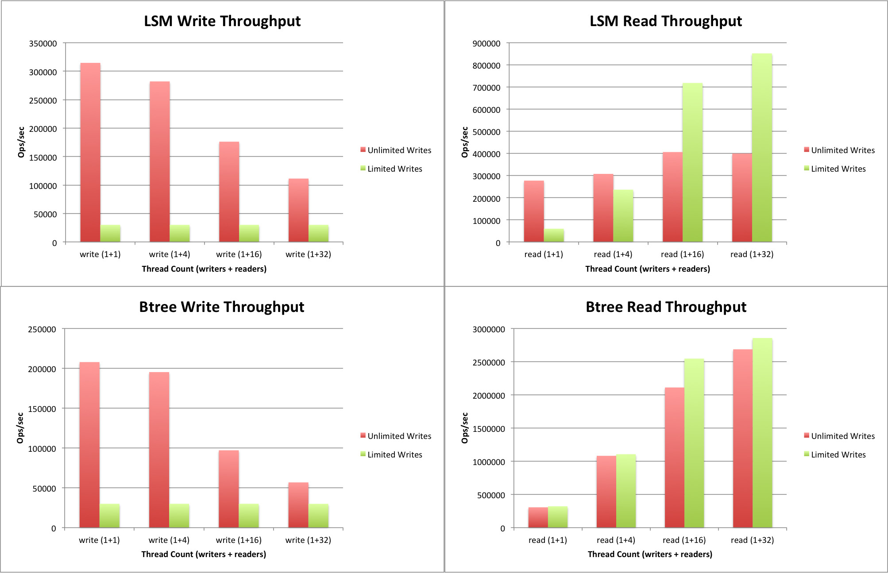
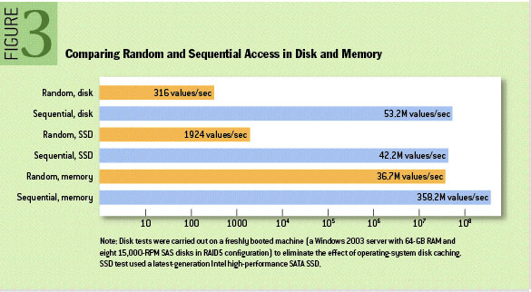

### LSM Trees

- where this could be useful
- why not a b-tree nor a in-memory hashmap
- whats a lsmtree & sstable
- benchmark

---

## Introduction

#### Storage engines

As known of, databases need to comply the ACID principles (even some NoSQL databases follow this principle like [MongoDB](https://www.mongodb.com/company/newsroom/press-releases/mongodb-announces-multi-document-acid-transactions-in-release-40)) and thus needing to implement a data structure being able to manage high writes & reads while having a relative low I/O cost and a transaction recovery.

Thinking about implementing a B-Tree is common, since most of relational databases uses them, although they are kindof limited when it comes off in a high write scenario. It would double the expensive in I/O since accessing random data is going to be much lower than sequential data[¹]. Instead, is it common to see b-trees and variants, like B+Trees, in highly demanding reads context (more on this later).

A log structured merge (LSM, for shorthand) tree is becoming the standard in NoSQL databases since it provides low-cost indexing for a file experiencing a high rate of record inserts (and deletes) over the long run, along side with a write ahead log (WAL) which makes possible to recover data in case of a unexpected shutdown of the system, although a WAL is not specific to LSMTrees only.

## The simple complexity of a modern LSMTree

As you might expect, implementing a modern storage engine is not easy. We will continuing with the LSMTree example and explaining one of its components.

#### SSTable

And to being with, the SSTable would be adequate. Why we dont use in-memory hash maps for these operations? [...]

## LSMTrees vs B-Trees

Both of these data structures are use in a context of write/read-heavy applications like storage engines, cdn's and data processing.

## References

⁰¹²³⁴⁵⁶⁷⁸⁹

- 1] The Log-Structured Merge-Tree (LSM-Tree) | https://www.cs.umb.edu/~poneil/lsmtree.pdf

